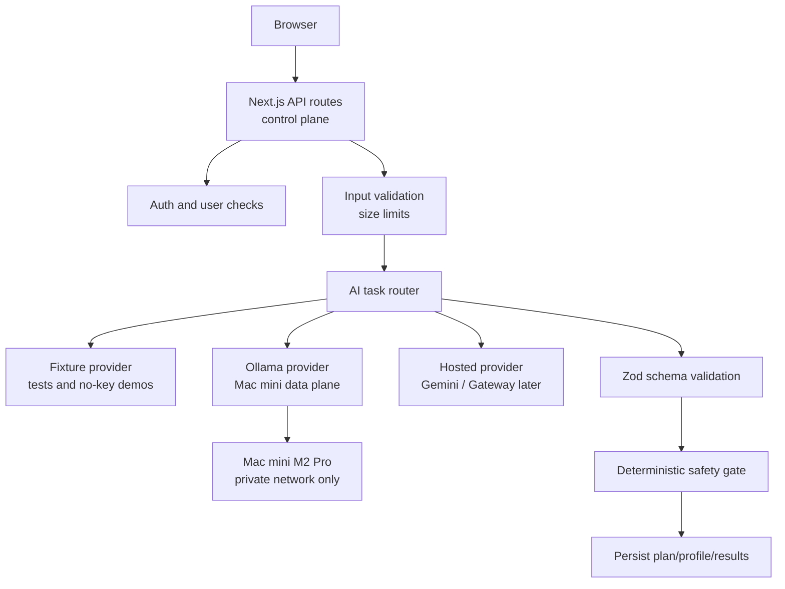

# t2ai AI Runtime Architecture

## Purpose

The AI runtime lets `t2ai` use free local models during development while keeping a clean path to hosted frontier models later.

The core rule is:

`LLMs draft and explain. Deterministic code decides safety, validity, and persistence.`

## Control Plane And Data Plane

`t2ai` uses a split runtime:

- `control plane`: the Next.js app and API routes
- `data plane`: the model host that runs inference

For local development, the data plane is the user's Mac mini running Ollama. For hackathons or hosted demos, the data plane can be Gemini or a future AI gateway.



The browser never talks directly to Ollama. Only server-side code should know `OLLAMA_BASE_URL`.

## Provider Modes

The runtime supports these provider modes:

- `ollama`: default local mode, using an OpenAI-compatible Ollama endpoint
- `fixture`: deterministic no-model mode for tests and UI development
- `gemini`: explicit cloud mode for hackathons when a free API key is available

Cloud providers must be explicitly selected. The app must not silently fall back from local Ollama to a cloud model because that can send private user context to a third party without a clear operator decision.

## Environment Variables

Recommended local development config:

```bash
AI_PROVIDER=ollama
OLLAMA_BASE_URL=http://localhost:11434/v1
OLLAMA_TEXT_MODEL=llama3.2
OLLAMA_STRUCTURED_MODEL=gemma3:4b
OLLAMA_TIMEOUT_MS=30000
```

Mac mini data plane config from another machine:

```bash
AI_PROVIDER=ollama
OLLAMA_BASE_URL=http://mac-mini.local:11434/v1
OLLAMA_TEXT_MODEL=llama3.2
OLLAMA_STRUCTURED_MODEL=gemma3:4b
```

Hackathon cloud config:

```bash
AI_PROVIDER=gemini
GEMINI_MODEL=gemini-2.5-flash
GOOGLE_GENERATIVE_AI_API_KEY=...
```

No-key fixture config:

```bash
AI_PROVIDER=fixture
```

## Mac Mini Security Boundary

Ollama is an inference server, not an auth gateway. The placeholder `api_key` used by OpenAI-compatible clients should not be treated as real access control.

Required controls:

- keep Ollama on `localhost` when the app runs on the same machine
- if using LAN access, allow only private hosts such as `.local`, RFC1918 addresses, or Tailscale-style private addresses
- never expose raw port `11434` to the public internet
- if remote access is needed, prefer Tailscale or a reverse proxy with a real bearer token
- keep `OLLAMA_BASE_URL` server-only

## Model Routing

For a Mac mini M2 Pro with about 16 GB RAM:

| Task | Local model | Notes |
| --- | --- | --- |
| Short coach copy | `llama3.2` | Fast response, good enough for conversational copy. |
| Onboarding extraction | `gemma3:4b` | Better structured output and reasoning. |
| Workout plan draft | `gemma3:4b` | Balanced default for local development. |
| Plan adjustment draft | `gemma3:4b` | Must pass deterministic validation before mutation. |
| Smoke tests | `fixture` | Tests should not depend on a running model. |
| Optional quality mode | `gemma3:12b` | Useful later, but not the default on 16 GB RAM. |

Qwen can be revisited later when storage is less constrained.

## Safety Contract

Every AI task should follow the same contract:

1. validate request input before calling a model
2. call the selected provider with task-specific model and timeout settings
3. validate model output with Zod
4. run deterministic safety and business-rule checks
5. persist only validated, safe results
6. log metadata by default, not raw private prompt text

For fitness-specific flows, deterministic code must own:

- blocked movements for pain or limitations
- red-flag symptom handling
- volume and intensity bounds
- equipment compatibility
- workout mutation permissions
- technique score thresholds from pose metrics

## Failure Modes

The runtime should make these failures explicit:

- `AI_PROVIDER` is unsupported
- Ollama URL is malformed
- Ollama URL points at a public host without an explicit override
- local model is missing or Ollama is offline
- cloud provider is selected without a key
- model output fails schema validation
- model output passes schema validation but fails deterministic safety rules

The user-facing app should show a short coaching-safe error. Developer logs should include provider, task, model, latency, and failure class, but not raw injury notes or full prompts by default.
