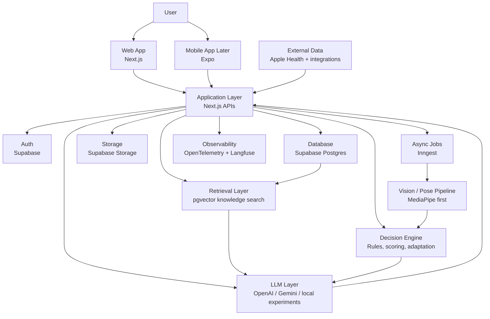
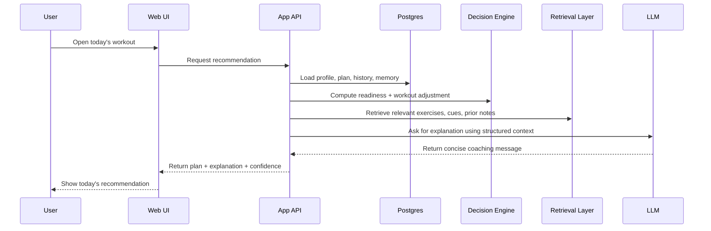
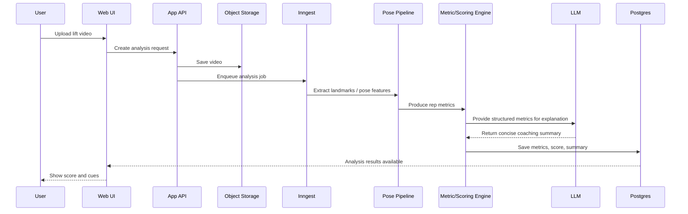

# t2ai System Design

## 1. Top-Level View

`t2ai` is an applied AI product with a hybrid architecture:

- deterministic systems own state, safety, scoring, and adaptation logic
- AI systems own extraction, retrieval-backed reasoning, explanation, and summarization

The product is intentionally designed as a portfolio-quality AI system, not just a chatbot UI.

## 2. System Goals

- generate personalized workout plans
- adapt workouts based on recovery, symptoms, and constraints
- support grounded coaching with retrieval and memory
- analyze exercise form from uploaded video
- expose modern AI engineering patterns in a realistic product

## 3. Architecture Diagram

## 4. Main Design Idea

The core system has five layers:

1. `experience layer`
2. `application layer`
3. `decision layer`
4. `AI layer`
5. `data and platform layer`

The cleanest mental model is:

`state -> deterministic decision -> AI explanation -> user action`

## 5. Layer-by-Layer Design

### 5.1 Experience Layer

Responsibilities:

- onboarding
- dashboard
- daily recommendation
- plan view
- workout adjustment chat
- video upload and results

Primary stack:

- `Next.js` App Router
- `React`
- `TypeScript`
- `Tailwind CSS`

Later:

- `Expo React Native` for phone-first flows

Why:

- fast product iteration
- good DX
- easy deployment
- works well for both product demos and real user-facing flows

Reference:

- [Next.js GitHub](https://github.com/vercel/next.js)
- [Expo GitHub](https://github.com/expo/expo)

### 5.2 Application Layer

Responsibilities:

- authenticate user requests
- expose product APIs
- validate inputs
- orchestrate AI, retrieval, and decision services
- persist results

Primary stack:

- `Next.js` route handlers and server-side logic
- `Zod` for schema validation

Reference:

- [Vercel AI SDK GitHub](https://github.com/vercel/ai)
- [Zod GitHub](https://github.com/colinhacks/zod)

Examples:

- `/api/profile`
- `/api/plan/generate`
- `/api/plan/adjust`
- future `/api/readiness/evaluate`
- future `/api/video/analyze`

### 5.3 Decision Layer

This is the most important non-LLM layer.

Responsibilities:

- calculate readiness state
- decide whether to push, maintain, reduce, or recover
- apply workout adaptation rules
- compute technique metrics and scores
- enforce safety constraints

Examples of deterministic logic:

- reduce volume when recovery is poor
- swap exercises when pain or equipment constraints change
- block heavy training when symptom red flags are present
- score squat depth, heel lift, and knee tracking from derived pose metrics

Why keep this deterministic:

- easier to test
- easier to explain
- safer than letting a model improvise training rules
- strong signal for applied AI interviews

### 5.4 AI Layer

The AI layer should help the product feel smart without becoming the sole source of truth.

Responsibilities:

- parse onboarding chat into structured profile data
- generate plan drafts with structured outputs
- explain workout changes in natural language
- run retrieval-backed coaching responses
- summarize video analysis results
- support model experimentation

Recommended design:

- `LLM for language and structure`
- `rules engine for final decisions`
- `retrieval for grounding`

Initial model strategy:

- hosted model for reliable product flows
- optional open-source models for experimentation and learning

Good uses of AI in this project:

- structured extraction
- explanation
- summarization
- query rewriting
- retrieval-backed generation

Bad early uses:

- letting the model make all training decisions
- letting the model infer injury risk directly from video

Open-source model references:

- [Qwen3 GitHub](https://github.com/QwenLM/Qwen3)
- [Qwen3 announcement](https://qwenlm.github.io/blog/qwen3/)
- [Gemma GitHub](https://github.com/google-deepmind/gemma)
- [Meta Llama 3.1 model card](https://huggingface.co/meta-llama/Meta-Llama-3.1-8B-Instruct)
- [Hugging Face Hub](https://huggingface.co/docs/hub/main/index)
- [Ollama model library](https://ollama.com/library)

### 5.5 Data and Platform Layer

Responsibilities:

- user identity
- profiles and plans
- workout history
- memory and knowledge storage
- video storage
- async processing
- logging and tracing

Recommended stack:

- `Supabase Auth`
- `Supabase Postgres`
- `pgvector`
- `Supabase Storage`
- `Inngest`
- `OpenTelemetry`
- `Langfuse`

Why:

- strong free tier / low-cost entry
- fast setup
- solid developer experience
- realistic production patterns without heavy ops burden
- clean separation between generic service telemetry and AI-specific traces

Reference:

- [Supabase architecture](https://supabase.com/docs/architecture)
- [Supabase billing overview](https://supabase.com/docs/guides/platform/org-based-billing)
- [Supabase billing FAQ](https://supabase.com/docs/guides/platform/billing-faq)
- [Inngest pricing](https://www.inngest.com/pricing)
- [Langfuse pricing](https://langfuse.com/pricing)
- [Langfuse GitHub](https://github.com/langfuse/langfuse)
- [OpenTelemetry](https://opentelemetry.io/)

## 6. How The Layers Connect

### Daily Coaching Flow

### Video Analysis Flow

## 7. Technology Stack

### Frontend

- `Next.js`
- `React`
- `TypeScript`
- `Tailwind CSS`

References:

- [Next.js GitHub](https://github.com/vercel/next.js)
- [React GitHub](https://github.com/facebook/react)
- [TypeScript GitHub](https://github.com/microsoft/TypeScript)
- [Tailwind CSS GitHub](https://github.com/tailwindlabs/tailwindcss)

### Backend / Product APIs

- `Next.js` server-side APIs for the first version
- optional future split to `FastAPI` if the vision and data pipeline grows enough to justify a Python service

Reference:

- [Vercel AI SDK GitHub](https://github.com/vercel/ai)

### Database / Auth / Storage

- `Supabase Auth`
- `Supabase Postgres`
- `pgvector`
- `Supabase Storage`

References:

- [Supabase architecture](https://supabase.com/docs/architecture)
- [Supabase billing overview](https://supabase.com/docs/guides/platform/org-based-billing)
- [Supabase billing FAQ](https://supabase.com/docs/guides/platform/billing-faq)
- [pgvector GitHub](https://github.com/pgvector/pgvector)

### AI / LLM

- current repo uses `Vercel AI SDK`
- hosted models for reliability
- open-source model experiments through `Ollama` or Hugging Face later

References:

- [Vercel AI SDK GitHub](https://github.com/vercel/ai)
- [Hugging Face Hub docs](https://huggingface.co/docs/hub/main/index)
- [Hugging Face pricing](https://huggingface.co/pricing)
- [Hugging Face Inference Providers pricing](https://huggingface.co/docs/api-inference/en/pricing)
- [Ollama](https://ollama.com/)
- [Qwen3 GitHub](https://github.com/QwenLM/Qwen3)
- [Qwen3 announcement](https://qwenlm.github.io/blog/qwen3/)
- [Gemma GitHub](https://github.com/google-deepmind/gemma)
- [Meta Llama 3.1 model card](https://huggingface.co/meta-llama/Meta-Llama-3.1-8B-Instruct)

### Async Workflows

- `Inngest`

Reference:

- [Inngest pricing](https://www.inngest.com/pricing)
- [Inngest JS GitHub](https://github.com/inngest/inngest-js)

### Observability / Evals

- `OpenTelemetry` for application traces, metrics, and logs
- `Langfuse` for AI-specific traces, prompt versions, model costs, sessions, and evals
- local eval scripts and curated test datasets

Recommended observability model:

- `OpenTelemetry` is the foundation
- `Langfuse` is the AI observability layer on top
- product analytics should stay separate from low-level telemetry

Why this split is useful:

- `OpenTelemetry` is vendor-neutral and good for general service instrumentation
- `Langfuse` is purpose-built for LLM workflows like prompts, retrieval, traces, scores, and evaluation
- this teaches both standard backend observability and modern AI observability

References:

- [OpenTelemetry](https://opentelemetry.io/)
- [Langfuse docs](https://langfuse.com/docs)
- [Langfuse pricing](https://langfuse.com/pricing)
- [Langfuse GitHub](https://github.com/langfuse/langfuse)

### Vision / Form Analysis

- `MediaPipe Pose Landmarker` for initial pose extraction
- optional future experiments with `MMPose`, `RTMPose`, `Ultralytics`, or vision-language models

References:

- [MediaPipe Pose Landmarker docs](https://ai.google.dev/edge/mediapipe/solutions/vision/pose_landmarker)
- [MediaPipe GitHub](https://github.com/google-ai-edge/mediapipe)

### Deployment

- `Vercel` for web app deployment
- `Supabase` managed services for database/auth/storage
- optional later worker service if video analysis grows beyond serverless comfort

References:

- [Vercel pricing](https://vercel.com/pricing/)
- [Supabase platform docs](https://supabase.com/docs/guides/platform)

## 8. Open Source Projects and Free Resources

### Core Open Source / Free-Friendly Tools

- `Next.js`
- `React`
- `TypeScript`
- `Tailwind CSS`
- `Zod`
- `Vercel AI SDK`
- `MediaPipe`
- `pgvector`
- `Inngest`
- `OpenTelemetry`
- `Langfuse`
- `Ollama`

### Free or Low-Cost Platform Choices

- `Vercel` hobby plan for early deployment
- `Supabase` free tier for early development
- `Inngest` free tier for workflows
- `OpenTelemetry` open standard and open-source ecosystem
- `Langfuse` open-source self-host option or starter cloud plan
- `GitHub` for source control and project visibility
- `Hugging Face` for model discovery and open-source experimentation

Supporting sources:

- [Vercel pricing](https://vercel.com/pricing/)
- [Supabase billing overview](https://supabase.com/docs/guides/platform/org-based-billing)
- [Supabase billing FAQ](https://supabase.com/docs/guides/platform/billing-faq)
- [Inngest pricing](https://www.inngest.com/pricing)
- [Langfuse pricing](https://langfuse.com/pricing)
- [Expo plans](https://docs.expo.dev/billing/plans/)
- [Hugging Face pricing](https://huggingface.co/pricing)
- [Hugging Face Inference Providers pricing](https://huggingface.co/docs/api-inference/en/pricing)

## 9. External Data Integrations

Integration strategy should stay narrow early.

Recommended order:

1. `manual user input`
2. `Apple Health`
3. `Hevy or internal workout logging`
4. `one recovery wearable`

Why:

- easier to reason about data quality
- easier to debug recommendation quality
- better learning value than integrating many sources too early

Reference:

- [Apple Health / HealthKit](https://developer.apple.com/documentation/healthkit)

## 10. Suggested Data Domains

Core entities:

- `users`
- `profiles`
- `plans`
- `workout_days`
- `workout_exercises`
- `workout_logs`
- `daily_readiness`
- `symptom_reports`
- `knowledge_chunks`
- `memory_items`
- `video_uploads`
- `analysis_runs`
- `rep_metrics`
- `feedback_reports`
- `llm_traces`
- `eval_runs`

## 11. Build Strategy

### Stage 1

- polished onboarding
- profile persistence
- plan generation
- dashboard

### Stage 2

- readiness-aware daily adaptation
- retrieval-backed explanations
- memory and history

### Stage 3

- video upload
- pose extraction
- metric scoring
- AI feedback summary

### Stage 4

- evals
- observability
- model routing
- external integrations

At this stage, observability should include:

- `OpenTelemetry` instrumentation across APIs and background jobs
- `Langfuse` tracing across prompts, retrieval, and AI outputs
- baseline metrics for latency, failures, token cost, and schema-validation errors

## 12. Why This Design Is Good For Learning

This architecture teaches the modern AI stack in a hands-on way:

- application and backend design
- auth and database modeling
- LLM product patterns
- RAG and memory
- evals and observability
- async pipelines
- multimodal systems
- real tradeoffs between rules and AI

That makes `t2ai` a strong stepping-stone project for roles like:

- `Applied AI Engineer`
- `AI Product Engineer`
- `AI Systems Engineer`
- `Backend Engineer on an AI product team`

## 13. Cost, Licensing, and Free-Tier Notes

These notes are here to keep the architecture grounded in what is realistically usable for a side project or low-traffic portfolio app.

- `Supabase`: open-source platform/components plus a managed cloud. The free plan currently allows two active free projects and includes quotas like `500 MB` database, `1 GB` storage, and `50,000` MAU. Sources: [Architecture](https://supabase.com/docs/architecture), [Billing overview](https://supabase.com/docs/guides/platform/org-based-billing), [Billing FAQ](https://supabase.com/docs/guides/platform/billing-faq)
- `Vercel`: managed hosting service, not open source as a hosted platform. The `Hobby` plan is currently free forever for personal projects. Source: [Vercel pricing](https://vercel.com/pricing/)
- `Inngest`: JavaScript SDK and ecosystem are developer-friendly and there is a free `Hobby` plan with usage limits for early projects. Sources: [Pricing](https://www.inngest.com/pricing), [inngest-js GitHub](https://github.com/inngest/inngest-js)
- `Langfuse`: open-source LLM engineering platform with both self-hosting and a free cloud hobby plan. Sources: [Pricing](https://langfuse.com/pricing), [GitHub](https://github.com/langfuse/langfuse)
- `Expo`: open-source app framework. `EAS` offers limited free builds and free updates, with monthly-reset limits. Sources: [Expo GitHub](https://github.com/expo/expo), [Expo plans](https://docs.expo.dev/billing/plans/)
- `Hugging Face`: the Hub has a free tier, and Inference Providers include a small free monthly credit for experimentation; larger hosted inference and dedicated endpoints cost extra. Sources: [Hub pricing](https://huggingface.co/pricing), [Inference pricing](https://huggingface.co/docs/api-inference/en/pricing)
- `OpenTelemetry`: open-source standard, no vendor lock-in by itself. Source: [OpenTelemetry](https://opentelemetry.io/)

## 14. Open-Source LLM Options For t2ai

For learning and experimentation, open-source or open-weight models are a good fit alongside hosted APIs.

- `Qwen3`: one of the strongest practical open-weight options for text and agent-style workflows; Qwen states its open-weight models are under Apache 2.0. Sources: [GitHub](https://github.com/QwenLM/Qwen3), [Qwen3 blog](https://qwenlm.github.io/blog/qwen3/)
- `Gemma`: Google DeepMind open-weight family with a strong ecosystem and practical local experimentation options. Source: [Gemma GitHub](https://github.com/google-deepmind/gemma)
- `Llama 3.1`: powerful and common, but licensed under Meta's custom community license rather than a standard OSS license. Source: [Model card](https://huggingface.co/meta-llama/Meta-Llama-3.1-8B-Instruct)
- `Ollama`: easiest local path for running open models during development. Sources: [Ollama](https://ollama.com/), [Qwen3 in Ollama](https://ollama.com/library/qwen3)

Recommended use in this project:

- hosted model for polished user-facing flows
- open model for local experiments, evals, prompt testing, and architecture learning
